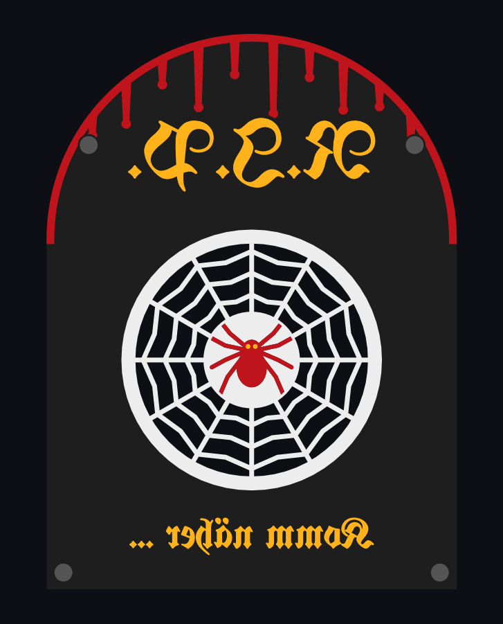

# Flüsternder Grabstein

Ein 3D-gedruckter Halloween-Grabstein für den Vorgarten. Kommt jemand vorbei, flüstert er. Bleibt jemand stehen, spricht Gustav, ein alter Geist, live mit den Besuchern. Gustav ist ein ElevenLabs-Konversationsagent.



## Hardware

| Teil | Aufgabe |
|---|---|
| Raspberry Pi 4 | Steuerung, Raspberry Pi OS Lite 64-bit |
| Seeed ReSpeaker XVF3800 (USB, ohne XIAO) | Mikrofon-Array mit Echounterdrückung, Audioausgang |
| Passiver Kleinlautsprecher mit PH2.0-Stecker | an der JST-Lautsprecherbuchse des ReSpeakers (Verstärker an Bord) |
| HC-SR501 | Bewegungsmelder: „jemand kommt“ |
| HLK-LD2410C | Radar: „jemand bleibt stehen“ |
| Netzteil USB-C 5 V / 3 A | Strom für den Pi |

## Verkabelung

Physische Pin-Nummern der 40-poligen Leiste:

| Bauteil | VCC | OUT | GND |
|---|---|---|---|
| Bewegungsmelder HC-SR501 | Pin 2 (5 V) | Pin 11 (GPIO17) | Pin 6 |
| Radar LD2410C | Pin 4 (5 V) | Pin 15 (GPIO22) | Pin 9 |

Der ReSpeaker hängt per USB am Pi. Der Lautsprecher steckt an der JST-Lautsprecherbuchse des ReSpeakers und bekommt dort Ton und Strom. Die Klinke am Pi bleibt frei. Die Zeichnung von oben liegt in [`software/verkabelung.html`](software/verkabelung.html) (im Browser öffnen).

## Aufbau des Repos

```
gehaeuse/    Gehäuse: parametrisches CAD (Python/manifold3d), STL, fertige Snapmaker-Orca-Projekte
software/    Programm für den Pi, Installer, Clip-Texte, Agent-Prompt
```

- Drucken und Montage: [`gehaeuse/LIESMICH.md`](gehaeuse/LIESMICH.md)
- Installation und Bedienung: [`software/LIESMICH.md`](software/LIESMICH.md)

## Schnellstart

```bash
# Ordner software/ als ~/grabstein auf den Pi kopieren, dann:
bash grabstein/install.sh
sudo nano /etc/grabstein/grabstein.env   # API-Key und Voice-ID eintragen
grabstein agent                          # legt den Agenten "Gustav" per API an
grabstein clips                          # erzeugt die Flüster-Clips
grabstein sensoren && grabstein ton && grabstein reden
sudo systemctl start grabstein
```

## Verhalten

- **Jemand kommt** (Bewegungsmelder): ein kurzer Flüster-Clip, danach 45 s Pause für Clips.
- **Jemand bleibt stehen** (Radar mindestens 4 s): Gespräch mit Gustav, höchstens 90 s, danach 120 s Pause.
- **Jemand geht** (Radar 8 s frei): Das Gespräch endet.
- **Mehrere Personen:** Ein laufender Clip oder ein laufendes Gespräch wird nie unterbrochen. Weitere Auslösungen in dieser Zeit verfallen, und ein Gespräch richtet sich an alle, die gerade davorstehen.
- **Kinder-Modus** bis 19:30, und immer solange die Uhrzeit nicht synchronisiert ist: nur liebe Clips, kein Gespräch.
- **Ohne Internet** oder wenn das Abendbudget (20 Gesprächsminuten) verbraucht ist, spielt er Clips statt eines Gesprächs.
- Außerhalb von 16:30–22:30 ist der Grabstein still.

Alle Werte stehen in `/etc/grabstein/grabstein.env` (Vorlage: [`software/grabstein.env.example`](software/grabstein.env.example)).

## Datenschutz

Der Agent speichert keine Sprachaufnahmen und hält Transkripte nur einen Tag (`grabstein agent` stellt das ein). Das Programm loggt keine Gesprächstexte, solange `LOG_TRANSKRIPTE=0` gesetzt ist. Gustav fragt nicht nach Nachnamen, Alter, Schule oder Adresse. Ein Hinweisschild am Zaun ist trotzdem sinnvoll.

## Lizenz

Privates Projekt. Die Schrift UnifrakturMaguntia steht unter der SIL Open Font License 1.1.
